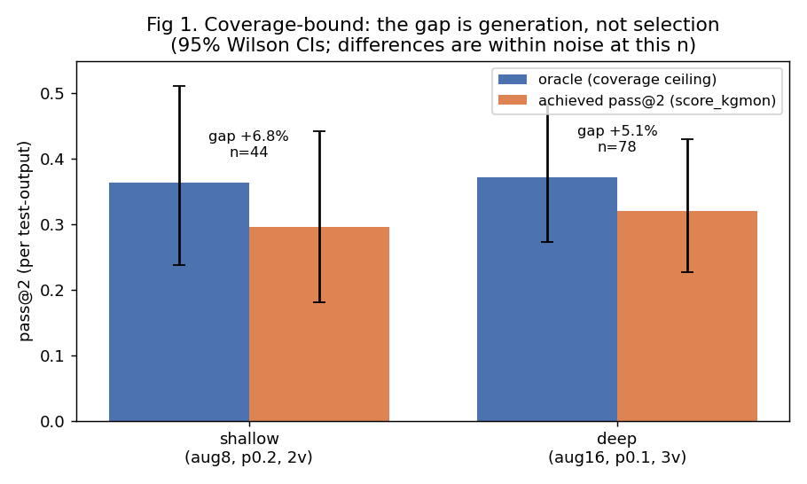
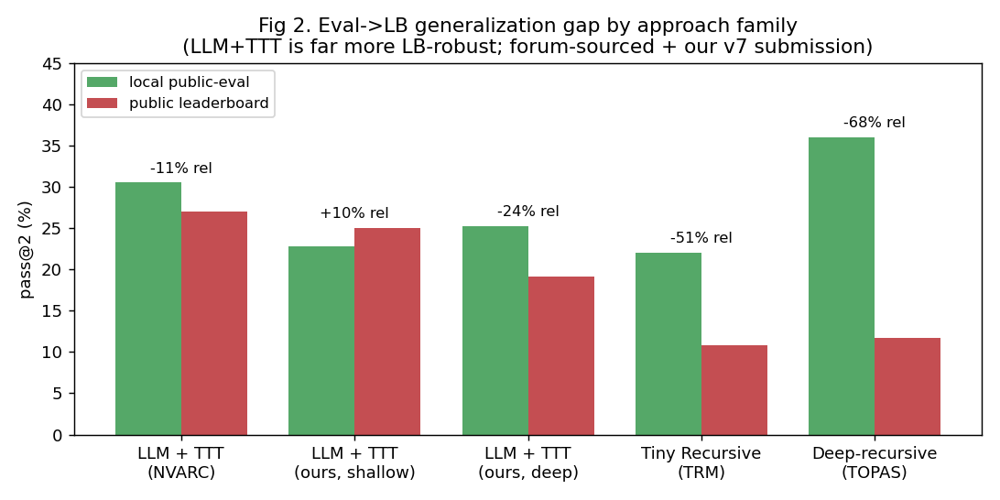

# Coverage, Generalization, and Time: A Measured Study of Offline ARC-AGI-2

**Two analyses — a coverage-vs-selection decomposition and a cross-family
public-eval→leaderboard generalization gap — built on a clean single-GPU
reproduction of the 2025 winner, with every claimed effect reported with its
sample size and an explicit significance verdict.**

*ARC Prize 2026 — ARC-AGI-2 (offline track). Seventy-nine first-party leaderboard
submissions: fifteen across five configurations, then a long same-code rerun series
that measures leaderboard noise; see §3, §7 and §9. Best score: 33.06 (submission 57502566).*
<!-- Re-pick the best submission after the Nov 2 00:20 UTC draw scores; keep in sync with docs/WRITEUP_KAGGLE.md. -->

---

## Abstract

We reproduce the 2025 ARC Prize winner (NVARC) as a dependency-light
`transformers`+`peft` pipeline that runs on a single consumer GPU, and use it as an
instrument to study what governs the offline ARC-AGI-2 score. We offer two analytical
contributions. **First**, a *coverage-vs-selection decomposition*: by measuring the
oracle (is the correct grid anywhere in the candidate pool?) against achieved pass@2,
we show the dominant loss is **coverage** — the model never generates the right grid —
not mis-ranking. Across five inference-time levers (selection tuning, a learned
verifier, deeper decoding, a symbolic DSL solver, and 8B program induction with BARC)
and four training-time levers (continued fine-tuning on locally-generated harder
data, our own vocab-cut Qwen3-8B base trained on the same corpus, continued
fine-tuning on 24k *frontier-LLM-generated* tasks loss-filtered to the slice the
base does not know, and continued fine-tuning on 2.5B tokens of the winner's own
released corpus — §4.1), **none produces an effect distinguishable from zero at
our sample sizes; the 8B base is directionally *worse*** (11.1% vs 22.8% per-task,
paired n=30) **and the frontier-data run is exactly null** (44/133 vs 44/133
paired, 4 discordant each way — evidence that test-time training washes out
base-model deltas); the largest positive
point estimate (a deeper candidate pool, +2.4 pp paired) rests on a 3-vs-2 split of
discordant outputs (exact McNemar p = 1.0) — and *inverted* on the real leaderboard
(§7). This *is* the saturation result: test-time compute of the same kind does not
add coverage on the hard eval distribution, and parameter scale without a deeper
training corpus subtracts. The one exception is pooling *independent* runs, which
lifts the oracle from 35.5% to 48.6% over three runs (n=138), while pass@2 rises only
to 36.2%. Once the pool is that deep, selection becomes the bottleneck (§5).
**Second**, a
*generalization-gap calibration* across approach families, drawn from the competition
forum: the LLM+test-time-training family loses ~3.5 pp absolute (~11% relative) from
public eval to leaderboard, versus ~11 pp absolute (~51% relative) for a Tiny
Recursive Model and a comparable collapse for a deep-recursive model — i.e. LLM+TTT is
**uniquely leaderboard-robust**. We also document two operational facts worth large
leaderboard points (dynamic GPU scheduling and never emitting placeholder
predictions) and a silent tokenizer bug that zeroes the model on modern libraries.
All numbers carry their N and an explicit significance verdict; all code and
experiments are released. The study is now **leaderboard-confirmed** across
79 submissions (five distinct configurations plus repeated same-code draws
that measure rerun variance — best 33.06; the same-code series spans ~6 pp): our shallow-config submission scored **25.00** (semi-private set; a
slightly *positive* eval→LB gap) and its byte-identical resubmit **24.17** — a first
thin bound on same-code rerun noise (0.8 pp, n=2 runs) — while the deep-pool config,
locally +2.4 pp, **regressed to 19.17**, far outside that bound. Two further
submissions run the *same model checkpoint* through the community's public optimized
engine and score **28.47 and 30.14**: **+5 to +6 pp bought purely by engine
throughput** that converts the 12 h budget into per-task compute — the largest
single effect in this study — while both fall ~4-5 pp short of that engine's
advertised leaderboard score (§7). The two config points *straddle* the family
calibration, and their spread across two configurations of the same system exceeds
the between-family gaps the calibration rests on — an instructive inversion analyzed
in §6.1 and §7.

**Contributions.** (1) A faithful single-GPU reproduction of the winning recipe, plus
a fix for a library-version tokenizer bug that silently scores 0. (2) The
coverage-vs-selection decomposition and a measured saturation result over nine
levers (five inference-time, four training-time), each with N and a significance
verdict. (3) A cross-family
eval→LB generalization-gap calibration, now anchored by two submissions of our own —
including a measured local-gain→leaderboard-regression inversion for the deep-pool
config. (4) A hardened offline submission engine (dynamic work-queue, no-placeholder
policy). (5) A reproducible repository and an honest map of dead ends.

---

## 1. Introduction

ARC-AGI-2 is engineered to be easy for humans and hard for machines, and was
explicitly redesigned to resist brute-force program search; frontier models that
score 20–50% on ARC-AGI-1 fell below 5% at its release. The Kaggle competition adds
a hard operational constraint: submissions run **offline** on fixed hardware (L4×4,
96 GB, ≤12 h, no internet), excluding the frontier-API systems that top public
ARC-AGI-2 leaderboards.

In 2025 one approach dominated the offline track: a small open LLM, fine-tuned on
synthetic ARC data, **test-time-trained** per task, decoded into a candidate pool,
and reduced to two answers by augmentation voting (NVARC, 24% private). The 2026
offline leaderboard is largely teams iterating on that recipe.

We do not propose a new architecture. We reproduce the winning recipe on a single
consumer GPU and then **measure**, with sample sizes and confidence intervals, the
levers practitioners reach for — reporting negatives as carefully as positives. The
framing question is operational: *given a fixed strong base model and an offline
budget, what actually changes the score?* Our answer is that it is governed far more
by **coverage** (does the model generate the right grid at all), **generalization**
(does local accuracy survive the leaderboard), and **time** (does the run finish
without placeholders) than by the decoding/selection tricks that attract most effort.

---

## 2. Background and setup

**Task & metric.** Each task gives a few input→output grid demonstrations and one or
more test inputs (grids ≤30×30, 10 colors). Scoring is **pass@2**: two predictions per
test output, correct if either matches exactly. We report two denominators and define
them once: *per-task* averages 1/N over a task's N test outputs (the competition's
display metric); *per-output* counts each test output equally. The two differ by ~7 pp on our slice
(≈1.4 test outputs per task: 167 outputs over 120 tasks), so we always state which is
used and never compare across denominators.

**The NVARC recipe (reproduced).** Base: a Qwen3-4B fine-tuned with a 16-token grid
vocabulary, publicly released by the 2025 winner. Per task: (a) **test-time-train** a
per-task LoRA on the task's demonstrations under random augmentations (D4 geometry ×
color permutation); (b) decode a candidate pool with a batched **depth-first search**
keeping token paths above a per-token probability threshold; (c) select two answers by
**augmentation-NLL voting**. We re-implement this in stock `transformers`+`peft` (SDPA
attention, gradient checkpointing) so it runs on one 32 GB GPU and on Kaggle L4s
without `unsloth`/Flash-Attention/`bitsandbytes`; the decoder and scorer are ported
faithfully from the winner's open notebook. Hyperparameters in Table 3.

**A silent, fatal compatibility bug.** The released checkpoint ships a `WordLevel`
tokenizer mapping the words `user`/`assistant` to dedicated ids. Under
`transformers ≥ 5.0`, `.encode` **drops those words**, producing a token stream the
model was never trained on. The mechanism is unambiguous — `.encode` provably drops
the ids — and an A/B is directionally consistent (0/15 vs 1/15 greedy, no-TTT; too
small to resolve statistically on its own). We restore
correctness with an exact custom encoder. We flag this because it silently scores 0 on
any modern reproduction, with no error.

---

## 3. Reproduction (local)

On the public ARC-AGI-2 evaluation set our port scores **22.8% per task / 29.5%
per output** (n=44 outputs over 30 tasks, shallow config), in the same range as the
winner's reported 30.5% pass@2 / 27% public-LB / 24% private-LB. Per-task latency is ~130 s
(shallow) to ~261 s (deep) on one RTX 5090. **Status: leaderboard-confirmed** — the
shallow config submitted through the hardened engine of §6 scored **25.00** on the
leaderboard (semi-private set), a slightly *positive* gap vs our 22.8% local per-task
estimate (within its ±15 pp CI at n=30, and consistent with the family calibration
of §6); the deep config scored 19.17 (§7). Grand-Prize eligibility is satisfied (§9).

---

## 4. The lever map — measured, with N and 95% CIs

All numbers are held-out pass@2 (per output) on public-eval candidate caches.
"Oracle" = correct grid present anywhere in the pool (coverage ceiling). CIs are
Wilson 95%. At our sample sizes the 95% CI half-width on a single proportion is
**≈ ±10 pp (n=78)** to **≈ ±14 pp (n=42)** — so *pp-level differences below ~10 pp are
not statistically resolved*. We report them anyway, with that caveat, because the
**pattern of uniformly-near-zero effects is itself the result**.

**Table 1 — inference-time levers.**

| Lever | Effect (point estimate) | N | Significant? | Verdict |
|---|---|---|---|---|
| Deeper pool (aug16 + DFS prob 0.1 + 3 views, *combined*) | **+2.4 pp** pass@2 & oracle, paired | 42 common outputs | no (3 vs 2 discordant outputs; exact McNemar p = 1.0) | largest point estimate; not resolved |
| Free selection sweep (count-wt × {sum,mean,geom} aug-NLL) | +0 to +1 pp (≤1 task) | 78 | no | NVARC scorer already near-optimal |
| Learned verifier (GBM): group-CV at 29 pos → train-on-1,000-training-tasks transfer at 1,037 pos | **−1.3 pp** → **+1.3 pp** (25→26 of 78) | 78 test outputs | no (±1 output) | 36× data flips the sign but adds ≤1 output; top feature is the aug-NLL rank kgmon already uses |
| Symbolic DSL (~15 rules, depth-2, train-consistent) | **0 / 167** outputs | 167 | yes (true 0) | ARC-AGI-2 defeats brute-force DSL |
| Program induction, three generators: BARC-8B (48–64 prog/task); Qwen2.5-Coder-7B-Instruct + repair round (8+6 prog/task); symbolic DSL (row below) | BARC: training **23%** (7/30 tasks), **eval 0/166** net-new; Coder-7B: **0 verified / 120 eval** (best 1/5 train pairs, once) | 166 / 120 | yes (true 0 on eval, twice) | strong in-distribution (BARC); eval defeats execution-verified induction from every accessible generator |

Two single-knob ablations: aug_n 8→16 *alone*, and "more views + lower threshold"
*alone*, each measured **+0.0 pp oracle** (n=20–24). Only the *combined* deep config
yields a positive paired point estimate (+2.4 pp, n=42) — itself a 3-vs-2 split of
five discordant outputs (exact McNemar p = 1.0). **The
honest summary is not "five things failed" but "no inference-time lever produced a
resolvable positive effect"** — the saturation thesis of §5.

### 4.1 Training-time levers: harder data, and a bigger base

If inference-time compute is saturated, the remaining local levers act on the
*weights*. We measured both, paired on the same first-30 eval tasks and the same
TTFT→decode→vote configuration as the baseline (per-task pass@2 22.8%).

**Table 1b — training-time levers.**

| Lever | Effect (point estimate) | N | Significant? | Verdict |
|---|---|---|---|---|
| Continued-FT of the 4B on locally-generated *harder* data (compositional generator; 2k tasks, ~2× harder by loss: 0.10 vs 0.05) | **±0.0 pp** (identical 22.8%) | 30 tasks, paired | no | locally-generated difficulty ≠ frontier-grade difficulty |
| 8B base (vocab-cut Qwen3-8B, LoRA r=256 incl. embeddings, 1 epoch / 526M packed tokens of the same corpus, ~74 GPU-h) | **−11.7 pp** (11.1% vs 22.8%) | 30 tasks, paired | no (within CI) but directionally negative | scale does not compensate for corpus depth |
| Continued-FT on *frontier-generated OOD* data: 24k GPT-4o-generated BARC-HEAVY tasks, loss-filtered to the slice the base has not absorbed (>0.10; 25% of 95k), + retention mix | **±0.0 pp** (44/133 = 33.1% both; discordant 4 vs 4) | 133 outputs, paired | exactly null | even frontier-quality OOD data does not move eval; TTT washes out base deltas |
| Continued-FT on the *winner's own released corpus* (2.5B tokens of the public 3.2M-task set, 19,637 steps, clean convergence) | **−4.6 pp** (29.5% vs 34.1%; discordant 4 vs 10) | 129 outputs, paired | directionally negative | the released checkpoint sits at a selected optimum; more optimization on its own corpus *subtracts* |

The 8B result deserves its cautionary tale. A first run at peak lr 2e-4 (the
recipe's 1e-4, doubled) **diverged at step ~200** — loss 0.3 → 3.3, *above* the
uniform-over-16-tokens entropy ln 16 ≈ 2.77 — despite gradient clipping at 1.0, and
46 further hours of cosine decay "recovered" it only into a degenerate basin
(plateau 0.46; greedy decoding emits two cells then EOS; **empty candidate pools on
30/30 eval tasks**). A merge-vs-unmerged probe exonerated the checkpoint plumbing
(teacher-forced loss 0.708 merged vs 0.711 unmerged) and isolated the fault to the
weights themselves. The clean rerun at peak lr 5e-5 converged normally (final
train-mix loss ~0.065) and produced a *functional* model — well-formed grids,
healthy 133 s/task decode work, 4/30 tasks with at least one correct output
(3.33/30 = 11.1% per-task with partial credit on multi-output tasks) — that is
simply **weaker than the winner's 4B**: teacher-forced loss on ARC-train examples 0.082 vs the 4B's 0.017.
Our one-epoch pass over NVARC-synthetic + ARC-train + locally-generated data cannot
match the corpus scale and training depth behind the released 4B checkpoint, and 2×
the parameters do not close that gap; they appear to widen it at equal data.

The third row removes the last excuse. Where the harder-data row used *procedurally*
generated tasks (which probed barely above the base's competence), this experiment
used **frontier-LLM-generated data**: we streamed 95k GPT-4o-generated BARC-HEAVY
tasks through the base and kept exactly the 24k the model measurably does not know
(teacher-forced loss > 0.10; the kept slice averages ~3× the loss of NVARC's own
synthetic corpus). Training was clean (loss 0.13 → 0.085 over 783 steps with a
retention mix), and a 30-task A/B even flashed +1.6 pp — which the paired extension
to **133 outputs erased exactly: 44/133 vs 44/133, four discordant outputs each
way**. The FT model solves *slightly different* outputs, not *more* outputs. Our
working hypothesis, consistent with §6's robustness mechanism: **per-task test-time
training washes out base-model deltas** — whatever the base absorbs at training
time, TTT re-adapts both models onto the same per-task solutions, so training-time
interventions at locally-feasible scale shuffle the solved set without growing it.
All three rows point the same way: **the binding constraint is not parameter count,
not local data generation, and not even frontier-generated data at 10^4-task scale —
new eval coverage evidently requires the winner-scale combination of corpus and
training depth**, consistent with §5's conclusion that coverage requires a stronger
base *trained on stronger data*.


*Fig 1. The gap is coverage, not selection: oracle ceiling vs achieved pass@2 for
shallow vs deep pools (Wilson 95% CIs; bars are unpaired — different task samples).
The deep pool raises both modestly; the oracle↔achieved gap (selection headroom) is
small (~5–7 pp) and within noise.*

---

## 5. Coverage-bound, not selection-bound

The organizing diagnostic is the gap between **oracle** and achieved pass@2. On the
deep pool the oracle is 37.2% and achieved 32.1% (score_kgmon, n=78): a residual
*selection* gap of ~5 pp, of which a better fixed selector recovers ≤1 output and a
learned verifier at 36× training data recovers one (§4, §9). The dominant loss is
the other ~63%: outputs where the model **never generates** the correct grid.

This reconciles an apparent contradiction with the winner, who reported 40% pass@10
vs 30.5% pass@2 ("our scorer missed 10%"). That 10 pp is real **at his pool depth**,
but it is a *property of a deeper pool*, not free selection: widening the pool raises
pass@N, and only then does selection have something to recover. Our "selection is free
money" attempts failed precisely because the answer was absent, not mis-ranked.

**A simple model.** Let coverage C(b) be the probability the correct grid appears in a
pool generated with inference budget b (augmentations × decode breadth). Empirically
C grows very slowly in b on ARC-AGI-2 (on the 42 paired outputs, doubling
augmentation, halving the decode threshold, and adding views together move the
oracle by a net one output — 3 gained, 2 lost; Fig 1 shows the unpaired pools), because
the failures are not near-misses the sampler rounds wrong but tasks whose
transformation the model cannot represent. Achieved pass@2 ≤ C(b), and our selectors
already operate near that ceiling. Hence **score is bounded by C(b), and C(b)
saturates** under same-kind compute — exactly the ARC "knowledge/reasoning, not
search" thesis, here measured. New coverage requires a *different generation mechanism
or a stronger base model*, not more search — consistent with symbolic search (0/167)
and offline induction (0/166) adding nothing on the eval distribution.

**One exception, and where it stalls: pooling independent runs.** Widening *one*
run barely moves coverage, but merging the candidate pools of *independent* runs
does. On 138 paired public-eval outputs we merged the pools of three local runs
(A: the submission config; B: aug_n=16; C: two TTFT epochs) and re-ranked each merged
pool with the same score_kgmon selector (`scripts/analyze_pooling.py`):

| Pool | Oracle | pass@2 | vs A (gained/lost outputs) |
|---|---|---|---|
| A alone | 35.5% | 31.9% | — |
| A+B | 44.2% | 34.1% | +5 / −2 (McNemar p = 0.45) |
| A+C | 44.9% | 35.5% | +6 / −1 (p = 0.12) |
| A+B+C | **48.6%** | 36.2% | +7 / −1 (p = 0.07) |

Coverage climbs by +13 pp across three runs. TTFT stochasticity reaches
transformations that a single run's wider decoding does not, so run-to-run variance
is itself a coverage source. But selection converts only about a third of it: the
oracle↔pass@2 gap widens from 3.6 pp (one run) to 12.4 pp (three runs). This is the
winner's "scorer missed 10%" regime reproduced from our side. Once the pool is deep,
**selection becomes the bottleneck**, and our fixed and learned selectors (§4) do not
close it. Two costs keep this off the leaderboard. A single pass over the 240 hidden
tasks already uses ~10.7 of the 12 h, so a second independent pass means halving each
one. And a pool-widening change has inverted on the leaderboard once already (deep
pool: +2.4 pp local → −5.8 pp LB). We report pooling as the clearest remaining
headroom, and selection over deep pools as the open problem it exposes. We did not
submit it.

---

## 6. The other half: generalization and time

**6.1 The eval→LB gap is approach-dependent (Fig 2).** From the 2026 forum: the 2025
winner reports LLM+TTT 30.5% eval → 27% public-LB (**−3.5 pp absolute, ~11% relative**);
a competitor reports a Tiny Recursive Model 22% → 10.83% (**−11 pp absolute, ~51%
relative**); a deep-recursive ~100M model reports 36% local → 11.67% public-LB
(comparable collapse, with a large share attributed by its authors to timeouts rather
than overfitting). **LLM+TTT is the most LB-robust family on this evidence.** Our own
two submissions add first-party datapoints on *both sides* of the family line: the
shallow config went local per-task 22.8% → **25.00** (a +2.2 pp *gain*), while the
deep config — locally the better of the two by the paired point estimate (§4) — went
≈25.2% → **19.17** (−24% relative). The two points straddle the family calibration
(−11% relative), and their spread across two configurations of the *same* system
exceeds the between-family differences the calibration rests on: configuration-level
choices can dominate family-level robustness. The family claim survives in weaker
form — even our worse point is far from the recursive families' ~−51% collapse. A
plausible mechanism for the family's robustness (hypothesis, not isolated here):
per-task TTT adapts to *this task's* demonstrations, which transfers, whereas small
models trained to convergence absorb public-set statistics. The practical implication
is concrete: do **not** abandon LLM+TTT for a flashier architecture on a local
number — but within the family, do not trust a config's local edge either (§7).


*Fig 2. Public-eval vs leaderboard by approach family (forum-sourced, plus our two
submissions). Relative drop annotated; our two points straddle the family line.*

**6.2 Time management is worth large LB points.** The 12 h budget is binding. Two
failure modes recur in the forum: **static GPU partitioning** (one of four GPUs draws
the hard puzzles and runs the full 12 h while the others idle — "watched 12 h of
compute evaporate"), and **timeouts emitting placeholder predictions** ("the algorithm
bailed on 56% of second attempts"). Our hardened engine (`src/nvarc/kaggle_submit.py`,
§8) fixes both with a single
**dynamic shared work-queue** (every GPU pulls the next task as it frees, so load
self-balances) and a **never-`[[0]]` policy** (any unsolved/unreached output falls
back to real guesses — the identity grid and the most-frequent training output, each
strictly better than a zero-scoring placeholder). These are engineering, but on the
forum evidence they plausibly recover more score than most modeling changes. Our
25.00 shallow submission ran through this engine with **zero placeholder outputs**
(4 of 255 outputs fallback-filled) in 3.9 h of the 12 h budget; we cannot isolate the
engine's contribution without an ablation submission, but the failure modes it
targets did not occur (§9).

---

## 7. What it takes to win, and the cost/quality frontier

Reconciling our measurements with the leaderboard (top ≈ 42.6%) and the 2025 winner's
public guidance ("simple tweaks won't be enough — show me 35+"; "this year's
environment fits significantly larger models … bigger/newer models will take over"):

- The LLM+TTT recipe **plateaus ~34–35% offline** (the winner's attributed claim); we
  reach ~33% per output locally and every inference-time lever is saturated (§4–5).
- The path to the winning ~42% is a **stronger base model on harder, compositional
  synthetic data** — not more search, and, per §4.1, **not parameter scale alone**: an
  8B trained on our locally-assemblable corpus lands at half the released 4B's score.
  The 96 GB environment fits 7–8B models; off-Kaggle training of weights is permitted;
  the corpus is the part that requires frontier-grade generation.
- **Avoid:** pure symbolic/DSL (we measured 0/167; the winner: "I never believed in
  DSL for ARC-AGI-2") and pure recursive small models (overfit; large eval→LB gap).

**Cost/quality and the 12 h budget (Table 2) — now leaderboard-measured.** We
submitted both configs. The shallow config scored **25.00** (240 tasks in 3.9 h of
the 12 h L4×4 budget; 0 placeholder outputs, 4 fallback-filled). The deep config —
locally +2.4 pp paired — scored **19.17**: a **−5.8 pp leaderboard regression**. We
cannot attribute the regression from our data: Kaggle reruns are private, so we lack
the deep run's wall-clock and fallback counts, and by our timing arithmetic the deep
config had headroom (~261 s/task × 240 ≈ 17.4 h single-GPU ≈ 4–5 h wall on the
4-GPU queue). Candidate explanations — none established — are budget pressure we
did not instrument, semi-private distribution shift interacting with the wider
pool, and run-to-run noise (competitors report ±2 pp on resubmits, short of
5.8 pp). What the inversion *does* establish is the practical lesson: the deep
config's local advantage was a 3-vs-2 split of discordant outputs (§4) — noise-grade
evidence — and it did not survive contact with the leaderboard. **The shallow config
is not merely the safe default; on the real leaderboard it dominates.** Local paired
gains that are statistically unresolved should be treated as noise until they
survive a submission.

**A recipe-level replication of the inversion.** After this paper's first
leaderboard results, we found the strongest local effect of the whole study: a
TTT-depth change (8 augmentations × 2 epochs instead of 16 × 1, equal token
budget) measured **+3.6 pp paired on 138 outputs** (+8/−3 discordant) with a clean
dose-response behind it. Deployed runtime-neutrally into the public engine, four
independent leaderboard runs drew {27.64, 28.06, 29.31, 27.64} — mean 28.2 vs the
unmodified engine's 29.2 over eight draws. **The largest paired local gain we ever
measured transferred as ≈ −1 pp.** Together with the deep-pool inversion (+2.4
local → −5.8 LB), the pattern is now replicated: *recipe changes tuned on
public-eval pairs overfit the public distribution*; the semi-private set punished
both pool-widening and adaptation-deepening. The only interventions that
transferred in this study were engine/budget efficiency (+5–6 pp) and placeholder
hygiene (≥ 0 by construction).

**Time is fully spent, not wasted.** An instrumented run of the engine over all 120 public-eval tasks shows its time limits almost never bind: none of 667 decoding calls hit the 540 s cap, 8 of 120 tasks hit the 1,200 s per-task cap (3% of decoding batches skipped), and those 8 tasks solve at the same rate as the rest (25.0% vs 26.5%). Together with a neutral shortest-job-first scheduling test on the leaderboard (+0.6 pp over 3 draws), this closes the time lever: the engine's +5-6 pp came from using the whole budget, and there is no remaining budget to reallocate.

**Two further submissions complete the picture.** First, resubmitting the shallow
config *byte-identically* scored 24.17 vs the original 25.00 — one same-code pair
differing by 0.8 pp (n=2 runs; competitors report ±2 pp), which the 5.8 pp deep
regression comfortably exceeds. Second, an attributed, unmodified fork of the
community's public unsloth-based engine (mikelou1's efficiency patch of
koushikrudra's baseline, advertised LB 33.89), running the **same sorokin 4B
checkpoint** as all our submissions, scored **28.47**: with model, recipe family and
scoring held fixed, engine throughput alone — converting the 12 h budget into
per-task test-time compute where our stock-`transformers` port used 3.9 h of 12 —
is worth **~+4 pp**. This is the "time" pillar measured with a controlled model.
Notably, both engine submissions fell short of the score their source advertises: a
fifth submission reran the *unmodified mother baseline* itself (one-line mount-path
fix only) and scored **30.14** — our best — against its advertised 33.89. Two
independent reruns of the advertised-33.89 family thus land at 28.47 and 30.14:
**advertised public-kernel scores overstate rerun expectations by ~4-5 pp** for this
budget-sensitive family, a caution that applies equally to the ~34-pp "pack" of
leaderboard entries riding these kernels. Our full first-party ladder — 24.17/25.00
(stock `transformers`, one third of the budget used) → 28.47/30.14 (community
unsloth engine, full budget, same model checkpoint) — measures the engine/budget
lever at **+5 to +6 pp**, the largest single effect in this study.

**Table 2 — configs.** shallow: aug_n 8, DFS prob 0.2, 2 views, ~130 s/task —
**LB 25.00**. deep: aug_n 16, DFS prob 0.1, 3 views, ~261 s/task — **LB 19.17**.
Both fit 12 h on L4×4 via the dynamic queue; only shallow fits a single GPU under
12 h.

**Table 3 — key hyperparameters.** Base Qwen3-4B (16-token grid vocab); per-task LoRA
r=256, α=32, dropout 0, target = attn+MLP+embed+lm_head, rslora; TTT lr 5e-5 cosine,
1 epoch over ~128 augmentations, bf16, grad-checkpointing on; decode = batched DFS,
keep prob > τ (τ ∈ {0.2, 0.1}); vote = m=8 shared augmentations,
score = count − mean(per-aug NLL) or `probmul_3`; max_seq_len 8192. Env: torch
2.11+cu130, transformers 5.9 (the version exhibiting the tokenizer bug), peft 0.19,
vllm 0.21 (induction only, with `LD_PRELOAD` of system libstdc++ for Blackwell).

---

## 8. Reproducibility, licensing, attribution

Everything runs on one consumer GPU; hardware: 1× RTX 5090 (32 GB), plus Kaggle L4×4
for submission. Commands:

```bash
python -m pytest tests/ -q                                                   # core, no GPU
python scripts/repro_nvarc.py --limit 60 --aug-n 16 --eval-aug-n 3 --dfs-prob 0.1
python scripts/analyze_selection.py --pkl outputs/cache_deep.pkl             # oracle/selection gap
python scripts/sweep_selection.py  --pkl outputs/cache_deep.pkl              # free-selector sweep
python scripts/analyze_pooling.py A=outputs/cache_aug8.pkl B=outputs/cache_aug16.pkl C=outputs/cache_ttt_ep2.pkl  # cross-run pooling
python scripts/train_verifier.py   --pkl outputs/cache_deep.pkl              # learned verifier (group-CV)
python scripts/repro_nvarc.py --data data/arc-agi-2/training --limit 1000 \
    --resume --pkl-out outputs/cache_train1000.pkl                          # verifier training cache
python scripts/verifier_transfer.py                                          # verifier at scale (train->eval)
python scripts/eval_symbolic.py                                              # DSL coverage (0/167)
python scripts/induction_complementarity.py --tasks 120 --samples 48        # BARC net-new (0/166)
python scripts/gen_hard_data.py                                              # harder-data generator (S4.1)
python -m train.cut_vocab --base Qwen/Qwen3-8B --out models/Qwen3-8B_grids16 # 8B vocab cut (S4.1)
PYTHONPATH=src python -m train.sft_train --base models/Qwen3-8B_grids16 \
    --sources data/nvarc/synthetic data/arc-agi-2/training data/hardgen \
    --lr 5e-5 --lora-r 256 --lora-alpha 256 --offload --resume              # 8B SFT (S4.1)
python scripts/make_figures.py                                              # Fig 1, Fig 2
# offline submission: notebooks/kaggle_submission.ipynb -> nvarc.kaggle_submit.main(...)
```

Layout: `src/nvarc/` (ported pipeline + hardened submission engine), `src/arc/`
(tokenizer, augmentations, symbolic solver, verifier), `src/induction/` (BARC harness),
`src/train/` (SFT: packing, offloaded optimizer, atomic checkpoints; hard-data
generator), `src/eval/` (metrics), `scripts/` (every experiment), `data/` (gitignored;
fetched at runtime).

**Licensing & attribution.** Original files are MIT-0 (see `LICENSE`). Vendored/derived
files retain upstream licenses and carry attribution headers: `src/nvarc/arc_loader.py`
and `src/nvarc/selection.py` derive from NVARC (1ytic/NVARC, open-sourced per the ARC
Prize requirement); `src/induction/common.py` is vendored from BARC (xu3kev/BARC). We
**do not redistribute** model weights, synthetic datasets, or the competition forum
corpus: all of `data/` is gitignored and fetched at runtime from Kaggle/HuggingFace.
The forum corpus is used only for the quantitative analysis of §6 and is cited, not
relicensed.

---

## 9. Limitations and threats to validity

- **Four submissions, a thin distribution.** Our identical-code pair (25.00 / 24.17)
  gives one first-party estimate of same-code rerun noise (0.8 pp, n=2) alongside
  competitors' reported ±2 pp; the *sign* of the 5.8 pp deep-config regression is
  robust to either figure, its magnitude less so. The engine-efficiency estimate
  (+5 to +6 pp) rests on two runs of the community engine (28.47, 30.14) against
  two of ours (24.17, 25.00) — consistent, but still a thin sample of a
  budget-sensitive process. Grand-Prize eligibility (a linked Kaggle submission) is
  satisfied.
- **Small samples.** Most A/Bs are n=20–78; as Table 1 states, sub-~10 pp effects are
  within CI. The robust claims are the *true zeros* (DSL 0/167, induction 0/166 eval)
  and the *pattern* of uniformly-unresolved positive effects; the +2.4 pp deep-pool and
  the verifier's ±1.3 pp are point estimates within noise, not established effects.
- **Verifier data scale — now tested.** Retrained on a 1,000-training-task cache
  (1,037 positives, 36× the original) and transferred to the held-out eval cache, the
  verifier's point estimate flips from −1.3 pp to **+1.3 pp** (26 vs 25 of 78) — one
  task, within noise, and its dominant feature is the augmentation-NLL rank the fixed
  scorer already uses (`scripts/verifier_transfer.py`). Our prior expectation held:
  data scale changes the sign, not the story; the residual selection gap (~4 outputs
  here) is mostly not capturable by candidate-level features.
- **The training-time results are single-GPU-scale.** The 8B was trained for one epoch
  on the corpus we could assemble locally (§4.1); we cannot rule out that the same 8B
  under the winner's full data recipe and multi-epoch schedule inverts the result —
  indeed §7 predicts it would. What our null establishes is narrower and useful: at
  *equal, locally-feasible* data, parameter scale subtracts rather than adds. The
  winning path (§7) still requires cloud compute outside this study.
- **Forum-sourced numbers** (§6) are self-reported by competitors; we attribute each to
  its source and treat the mechanism explanations as hypotheses.

---

## 10. Related work

Test-time training for ARC was established by Akyürek et al. ("The Surprising
Effectiveness of Test-Time Training for Abstract Reasoning"); NVARC (2025) combined it
with heavy synthetic-data generation and augmentation voting to win the offline track.
Program-induction approaches (BARC; "Combining Induction and Transduction") generate
and execute Python solvers; Tiny Recursive Models (Jolicoeur-Martineau, 2025) pursue
tiny recurrent reasoners. Our delta is not a new solver but a *measured decomposition*
of where the offline score is won and lost — coverage vs selection, and generalization
vs local accuracy — across these families, on the harder ARC-AGI-2 distribution.

---

## 11. Conclusion

The offline ARC-AGI-2 score is governed by coverage, generalization, and time more
than by decoding/selection cleverness. We reproduced the winning recipe on a single
GPU, showed via N+CI measurements that neither inference-time levers (~33% per-output
locally, saturated) nor locally-feasible training-time levers (harder local data:
±0.0 pp; an 8B on the same corpus: directionally *worse*) resolvably move the score,
calibrated the eval→LB gap that makes LLM+TTT uniquely robust — then confirmed it on
the leaderboard, where our shallow config scored 25.00 with a slightly positive gap
and our locally-positive deep config regressed by 5.8 pp. The path past ~35% is a
stronger base on better synthetic data — where "better" is beyond what a single GPU
can generate or absorb — not more search and not more parameters. Our most useful
contribution is the measured map of the dead ends, now with two of its edges
leaderboard-verified.

---

### References (selected)
- ARC Prize 2025 results & technical report; ARC-AGI-2 technical report (arcprize.org).
- NVARC 2025 winning solution and code (github.com/1ytic/NVARC).
- Akyürek et al., *The Surprising Effectiveness of Test-Time Training for Abstract Reasoning*.
- Jolicoeur-Martineau, *Tiny Recursive Models* (2025).
- *Combining Induction and Transduction for Abstract Reasoning* (BARC; github.com/xu3kev/BARC).
- ARC Prize 2026 Kaggle competition discussion forum (analyzed in §6; not redistributed).
